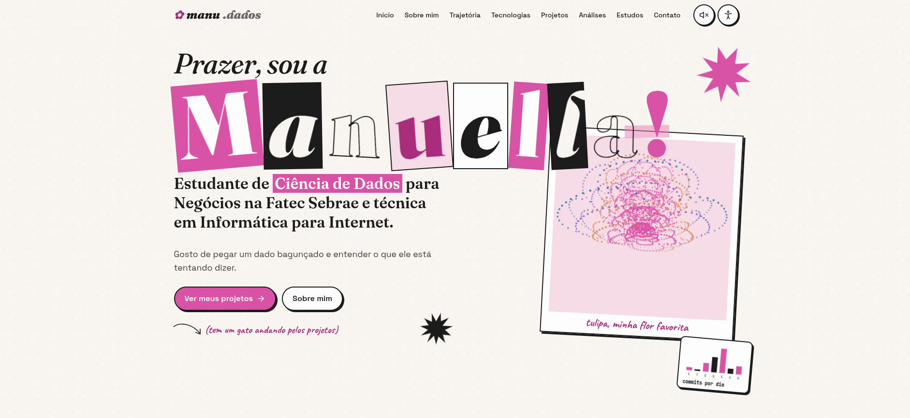

# Olá, sou a Manu!

Este é meu portfólio pessoal, onde reúno meus projetos, estudos e um pouco dos meus interesses fora da tecnologia.

**Acesse o site:** [manuellasantos.github.io/ola-sou-a-manu](https://manuellasantos.github.io/ola-sou-a-manu/)

Sou a **Manuella Santos Cruz**, estudante de Ciência de Dados para Negócios na Fatec Sebrae e técnica em Informática para Internet pela Etec Albert Einstein. Meu foco é **Ciência de Dados, Análise de Dados, Engenharia de Dados e Inteligência Artificial**.



## Objetivo

Quis desenvolver um portfólio que apresentasse meus projetos e que também me permitisse praticar Python, análise de dados e desenvolvimento web.

Além do catálogo com filtros e páginas individuais para os projetos, o site inclui uma análise da minha atividade no GitHub. Os dados são coletados pela API, tratados com Pandas e utilizados nos gráficos da seção "Minhas análises".

Também aproveitei o projeto para explorar aplicações da matemática nas animações. As coordenadas da rosa, a rede de habilidades e os dados da demonstração de k-means são gerados em Python com NumPy e renderizados no navegador.

Optei por não atribuir porcentagens de proficiência às linguagens de programação, já que quantidade de código e número de commits não são medidas de conhecimento técnico.

Os dados simulados são identificados, e as contribuições individuais nos projetos em equipe são descritas quando estão documentadas.

## Como o site está organizado

Preferi começar pela minha apresentação pessoal e trajetória, antes de mostrar minhas habilidades e meus projetos. No catálogo, os trabalhos relacionados a dados recebem maior destaque, considerando meu foco profissional.

| Seção | Conteúdo |
|---|---|
| Prazer, sou a Manuella! | Apresentação, letras recortadas, rosa de partículas e pequenos gráficos. |
| Sobre mim | Minha história e formação, com a participação de um suricato animado. |
| Além da tecnologia | Meus interesses pessoais: gatos, livros, Corvinal e Michael Jackson. |
| Minha trajetória | Etec, Fatec, cursos, SOEL, monitoria, iniciação científica, hackathons e conquistas. |
| Tecnologias que utilizo | Rede interativa que relaciona tecnologias aos projetos em que foram utilizadas. |
| Meus projetos | Catálogo com 11 projetos, filtros, páginas de detalhes e animação de moonwalk nos destaques. |
| Minhas análises | Análise da minha atividade no GitHub. |
| O que estou estudando | Iniciação científica, demonstração de k-means e arquitetura medalhão do Voebem. |
| Vamos conversar? | Contatos e um balão vermelho escondido. |

### Identidade visual

A principal referência visual foi o estilo scrapbook editorial. Escolhi combinar off-white, rosa e preto com letras recortadas, títulos serifados, estrelas, faixas animadas e texturas de papel.

Como gosto muito de rosa, tanto da cor quanto da flor, incorporei esses elementos ao design sem deixar o site inteiramente rosa.

Gráficos de dispersão, barras, linhas, matrizes de correlação e tabelas fazem parte das colagens. As capturas dos projetos são apresentadas em molduras de navegador e celular.

Também incluí referências aos meus interesses pessoais, como gatos, suricatos, Harry Potter, Stephen King e Michael Jackson.

## Como funciona

O projeto separa o processamento dos dados da apresentação das informações no navegador.

```text
Python (scripts/)                 JavaScript (src/)
─────────────────                 ─────────────────

API do GitHub
     │
     ▼
coletar_github.py
     │
     ▼
data/raw/github_bruto.json
     │
     ▼
processar_github.py
     │
     ▼
public/data/github.json ───────► Minhas análises


gerar_rosa.py
     └──► rosa.json ────────────► Rosa de partículas

gerar_rede_habilidades.py
     └──► rede.json ────────────► Rede de habilidades

gerar_clusters.py
     └──► clusters.json ────────► Borboleta e k-means

gerar_arte.py
     └──► arte.json ────────────► Elementos das colagens

gerar_graficos.py
     ├──► docs/img/*.png
     └──► docs/relatorio-github.html
```

Como o GitHub Pages hospeda arquivos estáticos, os scripts Python são executados localmente ou pelo GitHub Actions antes da publicação.

Os resultados são exportados em JSON e consumidos pelo React. O token do GitHub é utilizado no ambiente de execução dos scripts e não é enviado ao frontend.

O catálogo de projetos é centralizado em [`src/data/projects.json`](src/data/projects.json), o que permite cadastrar novos projetos sem alterar os componentes da interface.

### Responsabilidades de cada linguagem

**Python**

- Coleta de dados da API do GitHub.
- Limpeza e transformação dos dados.
- Cálculo de indicadores.
- Geração de gráficos com Matplotlib e Plotly.
- Cálculos matemáticos para as animações.
- Geração dos arquivos JSON utilizados pelo frontend.

**JavaScript**

- Leitura dos dados processados.
- Renderização das visualizações.
- Interatividade dos gráficos.
- Filtros e busca de projetos.
- Animações no navegador.
- Navegação entre páginas.
- Gerenciamento das preferências de acessibilidade.

## Estrutura de pastas

```text
ola-sou-a-manu/
├── .github/workflows/
│   ├── deploy.yml
│   ├── dados-github.yml
│   └── testes.yml
│
├── docs/
│   ├── prompts.md
│   ├── relatorio-github.html
│   └── img/
│
├── public/
│   ├── data/
│   ├── img/projetos/
│   └── audio/
│
├── scripts/
│   ├── coletar_github.py
│   ├── processar_github.py
│   ├── gerar_rosa.py
│   ├── gerar_clusters.py
│   ├── gerar_rede_habilidades.py
│   ├── gerar_graficos.py
│   ├── gerar_arte.py
│   ├── gerar_og.py
│   ├── gerar_tudo.py
│   └── utils.py
│
├── src/
│   ├── animations/
│   ├── components/
│   │   └── secoes/
│   ├── config/
│   ├── data/
│   ├── hooks/
│   ├── pages/
│   ├── services/
│   └── styles/
│
├── tests/
│   ├── js/
│   └── python/
│
├── requirements.txt
└── package.json
```

### Principais diretórios

| Diretório | Finalidade |
|---|---|
| `.github/workflows/` | Automação dos testes, atualização dos dados e deploy. |
| `docs/` | Documentação, exemplos de prompts, relatórios e gráficos. |
| `public/data/` | Arquivos JSON gerados pelos scripts Python. |
| `public/img/projetos/` | Capturas e imagens dos projetos. |
| `public/audio/` | Diretório reservado para arquivos de áudio autorizados. |
| `scripts/` | Coleta, tratamento, análise e geração de dados. |
| `src/animations/` | Implementação das animações. |
| `src/components/` | Componentes reutilizáveis e seções do portfólio. |
| `src/config/` | Configurações de navegação, caminhos e áudio. |
| `src/data/` | Informações pessoais e catálogo de projetos. |
| `src/hooks/` | Preferências, carregamento de dados e visibilidade dos elementos. |
| `src/pages/` | Páginas do portfólio. |
| `src/services/` | Filtros, áudio e armazenamento local. |
| `src/styles/` | Estilos, variáveis, layouts e animações. |
| `tests/` | Testes JavaScript e Python. |

## Tecnologias

### Desenvolvimento web

- React 18
- JavaScript
- Vite
- React Router (HashRouter)
- HTML
- CSS
- SVG
- Canvas

### Ciência de Dados e processamento

- Python
- Pandas
- NumPy
- Matplotlib
- Plotly
- Requests
- API do GitHub (REST e GraphQL)

### Testes, versionamento e deploy

- Vitest
- pytest
- Git
- GitHub
- GitHub Actions
- GitHub Pages

Optei por implementar as animações com CSS, SVG e Canvas, sem bibliotecas como GSAP ou Three.js. A ideia foi reduzir dependências e facilitar a compreensão e a manutenção do código.

## Análise de dados do GitHub

Uma das propostas do portfólio foi utilizar meus próprios dados públicos do GitHub como objeto de análise.

O processo foi dividido em três etapas:

### Extração

O script `coletar_github.py` consulta a API do GitHub e armazena os dados brutos em JSON.

### Transformação

O script `processar_github.py` utiliza Python e Pandas para organizar os registros, tratar os dados e calcular os indicadores apresentados no portfólio.

### Carregamento e visualização

Os resultados são exportados para `public/data/github.json` e consumidos pelo frontend.

O script `gerar_graficos.py` também gera gráficos com Matplotlib e um relatório interativo com Plotly, disponível em `docs/relatorio-github.html`.

As visualizações apresentam informações sobre minha atividade no GitHub, sem interpretar quantidade de código ou frequência de commits como medidas de proficiência técnica.

A análise considera a disponibilidade e as limitações dos dados fornecidos pela API.

## Rodando localmente

### Frontend

Instale as dependências:

```bash
npm install
```

Inicie o servidor de desenvolvimento:

```bash
npm run dev
```

O site estará disponível em:

```text
http://localhost:5173/ola-sou-a-manu/
```

### Ambiente Python

Crie um ambiente virtual:

```bash
python -m venv .venv
```

Ative o ambiente no Linux:

```bash
source .venv/bin/activate
```

No Windows:

```bash
.venv\Scripts\activate
```

Instale as dependências:

```bash
pip install -r requirements.txt
```

### Variáveis de ambiente

Crie uma cópia do arquivo de exemplo:

```bash
cp .env.example .env
```

O `GITHUB_TOKEN` é opcional, mas pode ser utilizado para acessar informações adicionais, como o calendário de contribuições.

Não compartilhe o arquivo `.env` nem disponibilize tokens no repositório.

### Gerando os dados

Para executar a coleta, o processamento e a geração dos arquivos utilizados no portfólio:

```bash
python scripts/gerar_tudo.py
```

Para utilizar os dados já coletados, sem realizar novas consultas pela internet:

```bash
python scripts/gerar_tudo.py --offline
```

Os scripts também podem ser executados individualmente. A finalidade de cada um está descrita no início do arquivo.

### Testes

Testes JavaScript:

```bash
npm test
```

Testes Python:

```bash
pytest tests/python
```

## Animações

Uma das partes que mais gostei de explorar neste projeto foi a combinação entre matemática, programação e elementos relacionados à minha personalidade.

Algumas animações utilizam coordenadas calculadas em Python, enquanto outras são implementadas diretamente no navegador com CSS, SVG e Canvas.

### Rosa de partículas

A rosa da página inicial é formada por 3.000 pontos de uma superfície paramétrica calculada com NumPy.

O Python gera as coordenadas e exporta os dados. No navegador, o Canvas realiza a projeção em perspectiva, a rotação da estrutura e a interação das partículas com o cursor.

### Moonwalk

Michael Jackson é meu artista preferido, então quis incluir uma referência a ele na seção de projetos.

O personagem é representado por um SVG original e realiza o moonwalk enquanto puxa o painel "Em cartaz".

O movimento das pernas utiliza cinemática inversa e a lei dos cossenos. Enquanto um pé permanece apoiado na ponta, o outro desliza para trás, reproduzindo a mecânica característica do passo.

### Borboleta e k-means

A animação começa com pontos organizados no formato de uma borboleta. Em seguida, esses pontos dão lugar a dados simulados utilizados em uma demonstração do algoritmo k-means.

A proposta é apresentar visualmente o processo de agrupamento dos dados.

### Rede de habilidades

As tecnologias são representadas por uma rede de conexões que relaciona cada ferramenta aos projetos em que foi utilizada.

A organização dos elementos utiliza o algoritmo Fruchterman-Reingold, explorando relações entre os nós da rede.

Uma pequena aranha acompanha a interação e desce até a tecnologia selecionada.

### Demais animações

| Animação | Seção | Funcionamento |
|---|---|---|
| Gato | Meus projetos | Caminha pela borda do catálogo, acompanha o cursor, senta e cochila. |
| Suricato | Sobre mim | Aparece atrás do card de formação e acompanha o cursor com os olhos. |
| Brasão da Corvinal | Página toda | Exibe um brasão original, movimenta as asas do corvo e reorganiza os projetos utilizando a técnica FLIP. |
| Balão vermelho | Vamos conversar? | Referência escondida a *It: A Coisa*, de Stephen King. |
| Letras recortadas | Início | As letras do nome entram com rotação e se acomodam na posição final. |
| Faixas animadas | Início | Duas faixas inclinadas se movimentam em sentidos opostos. |
| Água-viva | O que estou estudando | Movimento do sino e ondulação dos tentáculos. |

A interação da Corvinal pode ser ativada digitando `corvinal` ou selecionando a opção correspondente no mural.

As animações foram pensadas para não bloquear o acesso ao conteúdo. As animações das seções são acionadas quando entram na área visível da tela e respeitam as preferências de redução de movimento.

## Acessibilidade

O menu de acessibilidade está disponível no cabeçalho e reúne opções para personalizar a experiência de navegação.

### Recursos disponíveis

- VLibras, carregado quando ativado.
- Paletas alternativas para protanopia, deuteranopia e tritanopia.
- Modo de alto contraste.
- Ajuste do tamanho dos textos.
- Animações completas, reduzidas ou desativadas.
- Controle de áudio e volume.
- Restauração das configurações padrão.

As preferências são armazenadas localmente no navegador.

As paletas destinadas a pessoas com daltonismo alteram as cores utilizadas nos componentes e gráficos, em vez de apenas simular alterações na percepção visual.

Também são utilizados padrões, formas e rótulos para que a interpretação das informações não dependa exclusivamente das cores.

O site conta ainda com navegação por teclado, indicadores de foco visíveis, HTML semântico, textos alternativos, link para pular ao conteúdo principal e versões tabulares dos gráficos do GitHub.

As animações respeitam a configuração `prefers-reduced-motion` do sistema.

## Som

O áudio é desativado por padrão e depende da interação do visitante para ser reproduzido.

Os efeitos sonoros são originais, sintetizados com a Web Audio API, com curta duração e transições suaves de volume.

Minha ideia inicial era utilizar um trecho de *Billie Jean* durante o moonwalk, mas optei por não incluir músicas sem autorização.

A estrutura está disponível em [`src/config/audio.js`](src/config/audio.js). Caso eu obtenha um arquivo autorizado, posso adicioná-lo em `public/audio/` e configurar a propriedade `src`.

## Adicionando um projeto

As informações dos projetos estão centralizadas no arquivo:

```text
src/data/projects.json
```

Para adicionar um novo projeto:

1. Inclua um objeto seguindo a estrutura dos projetos existentes.
2. Preencha as informações, tecnologias, categorias e links disponíveis.
3. Adicione as capturas em `public/img/projetos/`.
4. Execute o script de atualização da rede de habilidades:

```bash
python scripts/gerar_rede_habilidades.py
```

Quando não existem capturas reais disponíveis, o projeto recebe uma capa conceitual identificada como ilustrativa.

## GitHub Actions

O projeto possui três workflows:

| Workflow | Finalidade |
|---|---|
| `deploy.yml` | Publicação manual no GitHub Pages. |
| `dados-github.yml` | Atualização dos dados do GitHub às segundas-feiras. |
| `testes.yml` | Execução dos testes JavaScript e Python a cada push. |

### Deploy

O workflow [`deploy.yml`](.github/workflows/deploy.yml) é executado manualmente, para que eu possa controlar quando uma versão será publicada.

Para realizar o deploy:

1. Acesse **Settings → Pages** no repositório.
2. Selecione **GitHub Actions** como fonte de publicação.
3. Acesse a aba **Actions**.
4. Selecione o workflow **Deploy no GitHub Pages**.
5. Clique em **Run workflow**.

O arquivo `vite.config.js` utiliza `/ola-sou-a-manu/` como caminho base.

O roteamento é realizado com HashRouter, permitindo que as páginas individuais dos projetos funcionem no GitHub Pages sem configurações adicionais de servidor.

## Uso de inteligência artificial no desenvolvimento

Utilizei o Claude Code, da Anthropic, como agente de apoio à programação durante o desenvolvimento deste portfólio.

Comecei com um prompt que reunia minha apresentação pessoal, meus projetos, referências visuais e requisitos técnicos. Depois, dividi o desenvolvimento em tarefas menores e fui ajustando as instruções conforme os resultados.

A ferramenta auxiliou em atividades como:

- Definição da arquitetura do projeto.
- Organização dos componentes e diretórios.
- Implementação dos scripts de coleta e tratamento dos dados do GitHub.
- Desenvolvimento das visualizações.
- Implementação matemática das animações.
- Aplicação de conceitos como cinemática inversa, superfícies paramétricas, Fruchterman-Reingold e k-means.
- Revisão dos recursos de acessibilidade.
- Criação de testes e documentação.

As decisões relacionadas ao conteúdo, à identidade visual, às prioridades e aos requisitos do projeto foram orientadas por mim.

Também conferi as informações dos projetos nos repositórios originais e solicitei explicações sobre partes do código que queria compreender e modificar posteriormente.

### Engenharia de Prompts

Ao longo do desenvolvimento, procurei estruturar as instruções considerando o contexto da tarefa, o objetivo, os requisitos técnicos e as restrições.

Utilizei referências visuais para direcionar o design, dividi funcionalidades mais complexas em etapas menores e refinei os prompts quando os resultados não correspondiam ao que eu esperava.

Um exemplo foi a reformulação da identidade visual. A primeira proposta não representava bem minha personalidade, então forneci novas referências e solicitei alterações na apresentação visual e nos textos, preservando as funcionalidades existentes.

### Exemplo de prompt — Análise de dados do GitHub

O prompt abaixo foi reorganizado para fins de documentação, mantendo a intenção do pedido original.

> **Contexto**
>
> Meu portfólio tem foco em Ciência de Dados, Análise de Dados e Engenharia de Dados. Quero utilizar minha própria atividade no GitHub como objeto de análise, demonstrando o processo de coleta, tratamento e visualização de dados.
>
> **Objetivo**
>
> Desenvolva um pipeline de dados integrado ao portfólio, utilizando informações públicas da API do GitHub.
>
> **Requisitos técnicos**
>
> - Utilize Python para consultar a API e armazenar os dados brutos.
> - Utilize Pandas para limpar, organizar e transformar os registros.
> - Calcule indicadores com base nas informações disponíveis.
> - Exporte os resultados em JSON.
> - Utilize o frontend apenas para consumir os dados processados e apresentar as visualizações.
> - Organize a coleta, o processamento e a apresentação em responsabilidades separadas.
>
> **Restrições**
>
> - Não invente métricas ou resultados.
> - Não utilize quantidade de código ou frequência de commits como medida de proficiência técnica.
> - Respeite as limitações da API.
> - Não exponha tokens ou credenciais no frontend.
> - Caso uma informação esteja indisponível, identifique a limitação em vez de gerar valores fictícios.
>
> **Critérios de aceitação**
>
> - Os scripts Python devem ser legíveis, documentados e executáveis independentemente do frontend.
> - Os arquivos JSON devem ser utilizados efetivamente nas visualizações.
> - Os gráficos devem apresentar a fonte dos dados, o período analisado e as limitações relevantes.
> - O processo de atualização dos dados deve estar documentado.
>
> Implemente a solução diretamente no projeto existente, reutilizando os componentes disponíveis e evitando dependências desnecessárias.

Esse prompt utiliza estratégias de contextualização, decomposição de tarefas, definição de restrições e critérios de aceitação.

Outros exemplos de prompts, incluindo as instruções utilizadas para desenvolver as animações, reformular a identidade visual, organizar os projetos e implementar os recursos de acessibilidade, estão disponíveis em:

[Documentação de Engenharia de Prompts](docs/prompts.md)

## Aprendizados

Este projeto me permitiu praticar conceitos de diferentes áreas, principalmente:

- Consumo de APIs.
- Processos ETL.
- Tratamento de dados com Pandas.
- Visualização de dados.
- Aplicações de matemática na programação.
- Algoritmos de agrupamento.
- Desenvolvimento de interfaces interativas.
- Acessibilidade digital.
- Testes automatizados.
- Versionamento com Git.
- Automação com GitHub Actions.
- Engenharia de Prompts.

Durante o desenvolvimento, percebi também a importância de fornecer instruções claras para ferramentas de inteligência artificial, revisar os resultados e compreender o funcionamento das soluções antes de incorporá-las ao projeto.

Além de apresentar meus trabalhos, o portfólio se tornou mais um espaço para praticar programação, estudar novos conceitos e experimentar ideias que normalmente não aparecem nos meus projetos acadêmicos.

## Contato

- **E-mail:** [cruzmanu435@gmail.com](mailto:cruzmanu435@gmail.com)
- **LinkedIn:** [Manuella Santos Cruz](https://www.linkedin.com/in/manu-cruz-8439332b6/)
- **GitHub:** [Manuellasantos](https://github.com/Manuellasantos)

---

*Todos nós flutuamos por aqui.* 🎈
